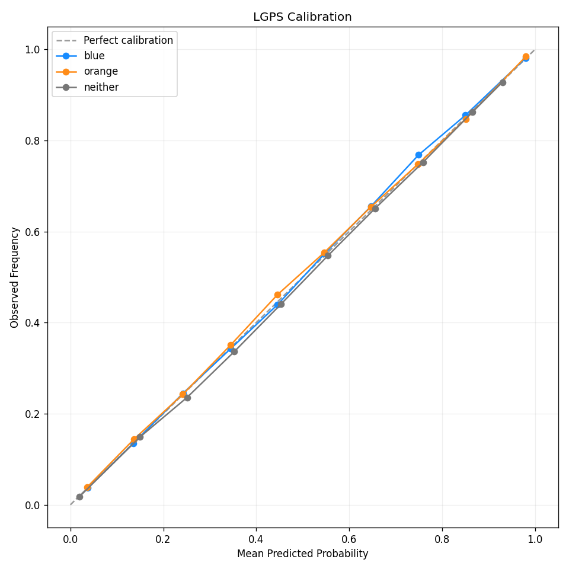
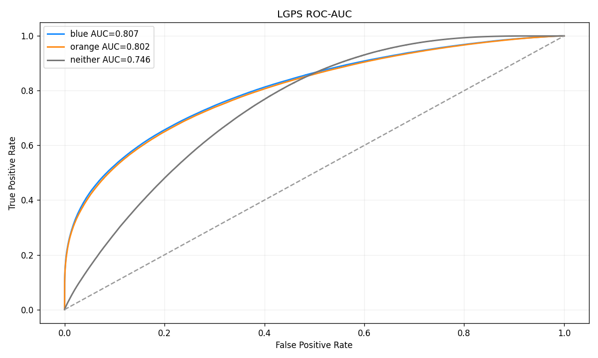
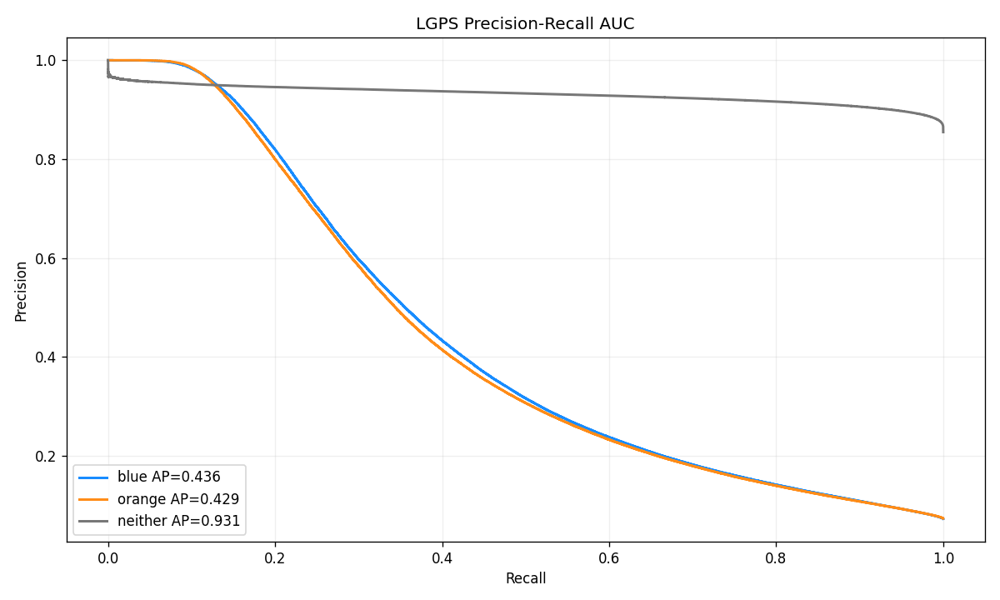
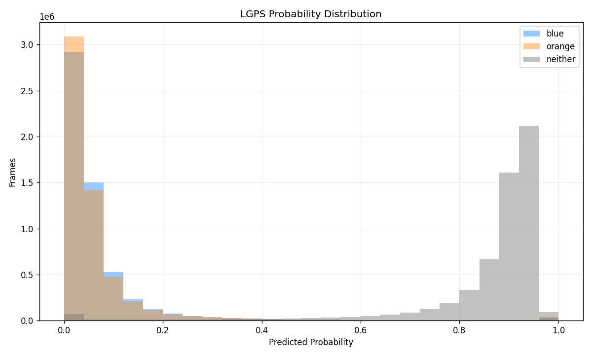
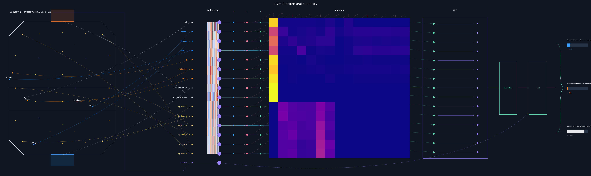
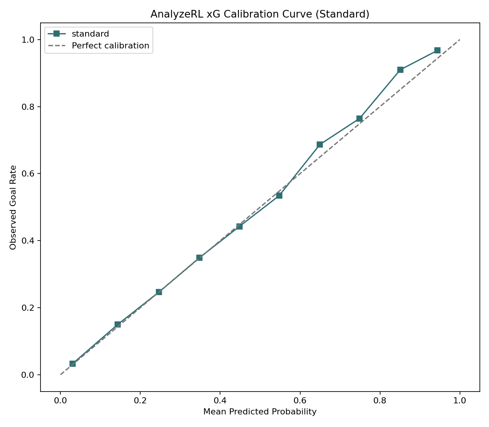
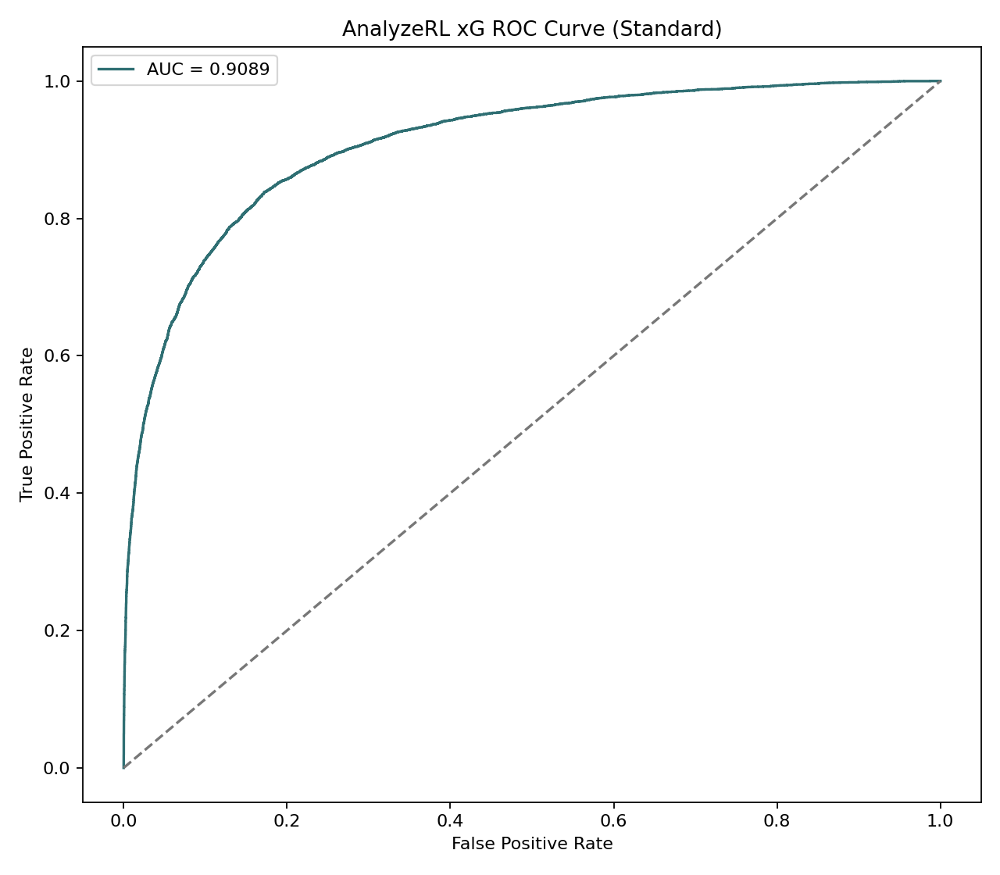

# Rocket League Neural Index

### Fine-Grained Evaluation of Human Gameplay Behaviours in Rocket League

Training Data: 
Rocket League replays collected from the following seasons and parsed with the [AnalyzeRL Boxcars library](https://pypi.org/project/analyzerl-boxcars):
- Season X
- 2021-22
- 2022-23
- 2024
- 2025

Testing Data:
Rocket League replays collected from the following seasons and parsed with the AnalyzeRL Boxcars library:
- 2026

Replay Files were collected from the following sources:
- https://www.kaggle.com/datasets/dster/rocket-league-rlcs-season-x-replays
- https://www.kaggle.com/datasets/dster/rocket-league-rlcs-season-2021-22-replays
- https://www.kaggle.com/datasets/dster/rocket-league-rlcs-season-2022-23-replays
- https://www.kaggle.com/datasets/dster/rocket-league-rlcs-season-2024-replays
- https://www.kaggle.com/datasets/dster/rocket-league-rlcs-season-2025-replays
- https://ballchasing.com

## [Latent Goal-Probability State](https://www.kaggle.com/models/owensingh38/latent-goal-probability-state)

### Estimating the latent quantification of the current momentum of Rocket League matches by frame.

Given high-resolution information on the position of a Rocket  League replay frame in play that occurs in between goals, how accurately can we identify its "latent goal-probability state"; that is, the underlying probabilities of one or neither team scoring within some period of time that describe the current "momentum" of the game.

Outputs from replay parsing yield data in 30 frames per second, or 30hz.  For each replay in these seasons, the full replay frames dataset is first downsampled into 10hz (hinged on the frames directly before a goal is scored) and then is reduced into mid-play frame states only.

### Architecture

```text
LGPSTransformer(
  (ball_stream): LGPSAgent(
    (network): Sequential(
      (0): Linear(in_features=13, out_features=128, bias=True)
      (1): GELU(approximate='none')
      (2): Linear(in_features=128, out_features=128, bias=True)
      (3): LayerNorm((128,), eps=1e-05, elementwise_affine=True)
    )
  )
  (player_stream): LGPSAgent(
    (network): Sequential(
      (0): Linear(in_features=102, out_features=128, bias=True)
      (1): GELU(approximate='none')
      (2): Linear(in_features=128, out_features=128, bias=True)
      (3): LayerNorm((128,), eps=1e-05, elementwise_affine=True)
    )
  )
  (goal_stream): LGPSAgent(
    (network): Sequential(
      (0): Linear(in_features=9, out_features=128, bias=True)
      (1): GELU(approximate='none')
      (2): Linear(in_features=128, out_features=128, bias=True)
      (3): LayerNorm((128,), eps=1e-05, elementwise_affine=True)
    )
  )
  (big_boost_stream): LGPSAgent(
    (network): Sequential(
      (0): Linear(in_features=7, out_features=128, bias=True)
      (1): GELU(approximate='none')
      (2): Linear(in_features=128, out_features=128, bias=True)
      (3): LayerNorm((128,), eps=1e-05, elementwise_affine=True)
    )
  )
  (context_token): LGPSAgent(
    (network): Sequential(
      (0): Linear(in_features=5, out_features=128, bias=True)
      (1): GELU(approximate='none')
      (2): Linear(in_features=128, out_features=128, bias=True)
      (3): LayerNorm((128,), eps=1e-05, elementwise_affine=True)
    )
  )
  (type_embedding): Embedding(4, 128)
  (team_embedding): Embedding(3, 128)
  (geometry): RelationalGeometry()
  (blocks): ModuleList(
    (0-3): 4 x LGPSTransformerBlock(
      (norm1): LayerNorm((128,), eps=1e-05, elementwise_affine=True)
      (attention): LGPSAttention(
        (q): Linear(in_features=128, out_features=128, bias=True)
        (k): Linear(in_features=128, out_features=128, bias=True)
        (v): Linear(in_features=128, out_features=128, bias=True)
        (out): Linear(in_features=128, out_features=128, bias=True)
        (geometry_bias): Sequential(
          (0): Linear(in_features=156, out_features=128, bias=True)
          (1): GELU(approximate='none')
          (2): Linear(in_features=128, out_features=8, bias=True)
        )
        (pairwise_source): Linear(in_features=128, out_features=256, bias=True)
        (pairwise_target): Linear(in_features=128, out_features=256, bias=True)
        (pairwise_source_role): Linear(in_features=13, out_features=8, bias=True)
        (pairwise_target_role): Linear(in_features=13, out_features=8, bias=True)
        (pad_geometry_bias): Sequential(
          (0): Linear(in_features=3, out_features=128, bias=True)
          (1): GELU(approximate='none')
          (2): Linear(in_features=128, out_features=8, bias=True)
        )
        (dropout): Dropout(p=0.05, inplace=False)
      )
      (norm2): LayerNorm((128,), eps=1e-05, elementwise_affine=True)
      (ffn): Sequential(
        (0): Linear(in_features=128, out_features=256, bias=True)
        (1): GELU(approximate='none')
        (2): Dropout(p=0.05, inplace=False)
        (3): Linear(in_features=256, out_features=128, bias=True)
        (4): Dropout(p=0.05, inplace=False)
      )
    )
  )
  (pool): LearnedQueryPooling(
    (norm): LayerNorm((128,), eps=1e-05, elementwise_affine=True)
    (attention): MultiheadAttention(
      (out_proj): NonDynamicallyQuantizableLinear(in_features=128, out_features=128, bias=True)
    )
  )
  (head): Sequential(
    (0): LayerNorm((256,), eps=1e-05, elementwise_affine=True)
    (1): Linear(in_features=256, out_features=128, bias=True)
    (2): GELU(approximate='none')
    (3): Dropout(p=0.05, inplace=False)
    (4): Linear(in_features=128, out_features=21, bias=True)
  )
  (ball_state_aux): LGPSBallStateAux(
    (feedback_projection): Linear(in_features=13, out_features=128, bias=False)
    (heads): ModuleDict(
      (1): Sequential(
        (0): LayerNorm((128,), eps=1e-05, elementwise_affine=True)
        (1): Linear(in_features=128, out_features=128, bias=True)
        (2): GELU(approximate='none')
        (3): Linear(in_features=128, out_features=13, bias=True)
      )
      (5): Sequential(
        (0): LayerNorm((128,), eps=1e-05, elementwise_affine=True)
        (1): Linear(in_features=128, out_features=128, bias=True)
        (2): GELU(approximate='none')
        (3): Linear(in_features=128, out_features=13, bias=True)
      )
      (10): Sequential(
        (0): LayerNorm((128,), eps=1e-05, elementwise_affine=True)
        (1): Linear(in_features=128, out_features=128, bias=True)
        (2): GELU(approximate='none')
        (3): Linear(in_features=128, out_features=13, bias=True)
      )
      (20): Sequential(
        (0): LayerNorm((128,), eps=1e-05, elementwise_affine=True)
        (1): Linear(in_features=128, out_features=128, bias=True)
        (2): GELU(approximate='none')
        (3): Linear(in_features=128, out_features=13, bias=True)
      )
    )
  )
  (next_touch_aux): LGPSNextTouchAux(
    (player_score): Linear(in_features=128, out_features=1, bias=True)
    (global_score): Linear(in_features=128, out_features=128, bias=True)
    (player_time): Linear(in_features=128, out_features=1, bias=True)
  )
)
```

### Results 

Model Metrics, Out-of-Sample Test Data:
- Log Loss (Collapsed, Three-Way): 0.396244
- Brier Score (Collapsed, Three-Way): 0.204049
- Macro ROC-AUC: 0.785107
- Macro PR-AUC: 0.598422






### Example Inference

```python
from analyzerl_boxcars import parse_replay

REPLAY = "data/frames/game.replay"
CHECKPOINT = "data/models/lgps/lgps_transformer.pt"

device = torch.device("cuda" if torch.cuda.is_available() else "cpu")

frames = parse_replay(REPLAY, event_tagging=False)

checkpoint = torch.load(CHECKPOINT, map_location=device, weights_only=False)

model_config = LGPSModelConfig(**checkpoint["model_config"])
model = create_model(model_config, train_config).to(device).eval(); 

model.load_state_dict({k.removeprefix("_orig_mod."): v for k, v in 
checkpoint["model_state_dict"].items()})

batch = {key: value.to(device) for key, value in 
EntityTokenizer(model_entities=model_config.model_entities)(frames).items()}

with torch.inference_mode():
    logits = model(batch["ball"], batch["players"], batch["goals"], batch["entity_types"], batch["entity_teams"], batch["game_context"], batch.get("big_boosts"), batch.get("small_boosts"))

probabilities = collapse_probabilities(logits.softmax(-1), model_config.targets_per_team).cpu().numpy()
```

### LGPS Architectural Summary



## [Expected Goals](https://www.kaggle.com/models/owensingh38/rl-expected-goals)

Given information of a frame in which a player initiates a shot attempt (based on in-game shot recording), can we estimate the likelihood the shot attempt will eventually score?

Using the frame that a shot is recorded in replay frame data, the touch initiating the shot is found by looking back and marking the last touch made by the shooting player as the shooting frame, which is where information on the shot is dervied from for the model.  

Because shot and goal events are not necessarily linked in replay data, this must be done heuristically.  These events are linked by looking back 120 frames (four seconds in our 30hz replay frames data) from the frame the goal is recorded and identifying an evaluated shot row in that interval, selecting the most recent shot by the goal scorer.

### Results

Model Metrics, Out-of-Sample Test Data:
- Log Loss: 0.273570
- Brier Score: 0.082013
- ROC-AUC: 0.908891




### Example Inference

```python
import joblib
import polars as pl
from pathlib import Path
from tempfile import TemporaryDirectory
from analyzerl_boxcars import parse_replay
from xg.dataset import load_training_frames, prepare_model_data, to_sparse_matrix

REPLAY = "data/frames/game.replay"
artifact = joblib.load("results/xg/standard/xg_model_standard.joblib")

with TemporaryDirectory() as directory:
    parse_replay(REPLAY, event_tagging=True).write_parquet(Path(directory) / "game_frames.parquet")
    shots = load_training_frames(
        directory, model_segments=artifact["model_segment"]
    )

features = prepare_model_data(shots)
xg = artifact["model"].predict_proba(
    to_sparse_matrix(features, artifact["feature_columns"])
)[:, 1]

scored_shots = shots.with_columns(pl.Series("xG", xg))
```

## License
Apache License 2.0. See [LICENSE](LICENSE).
